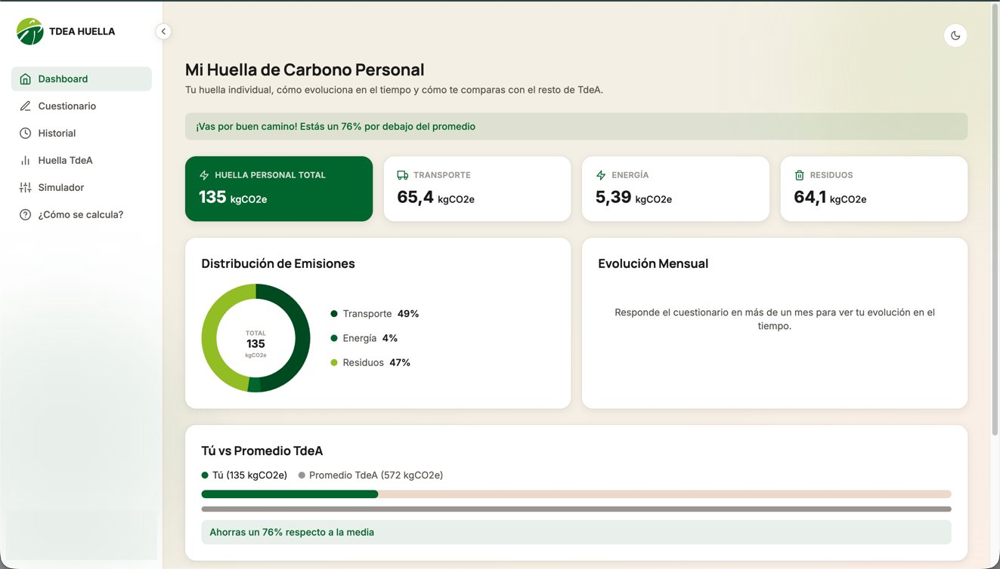
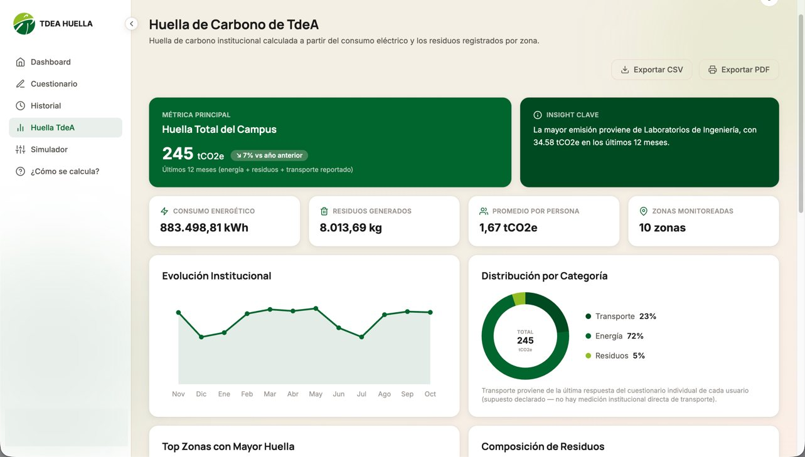
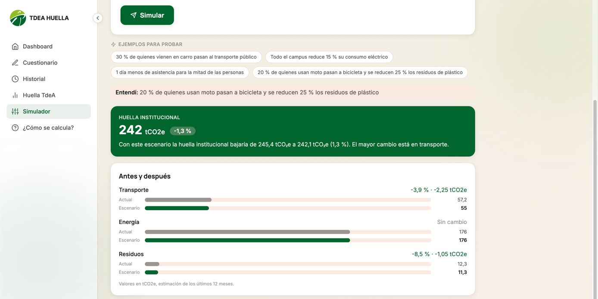
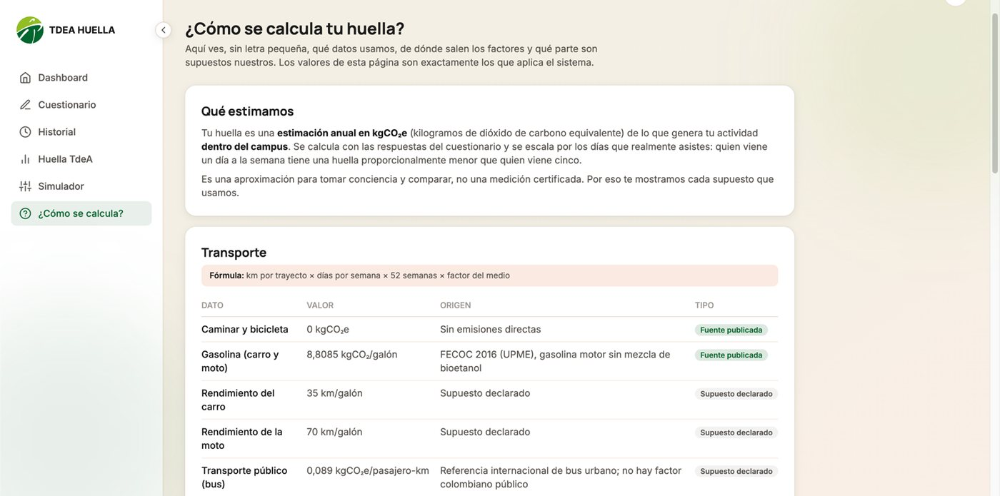
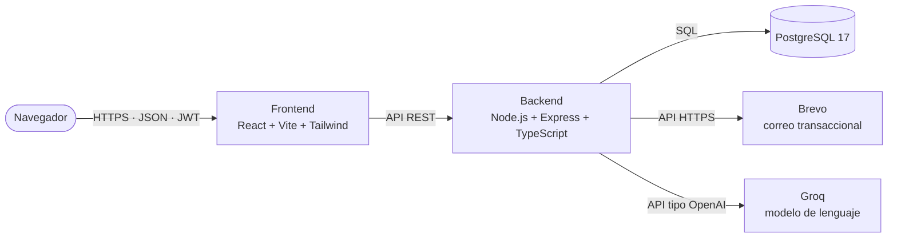
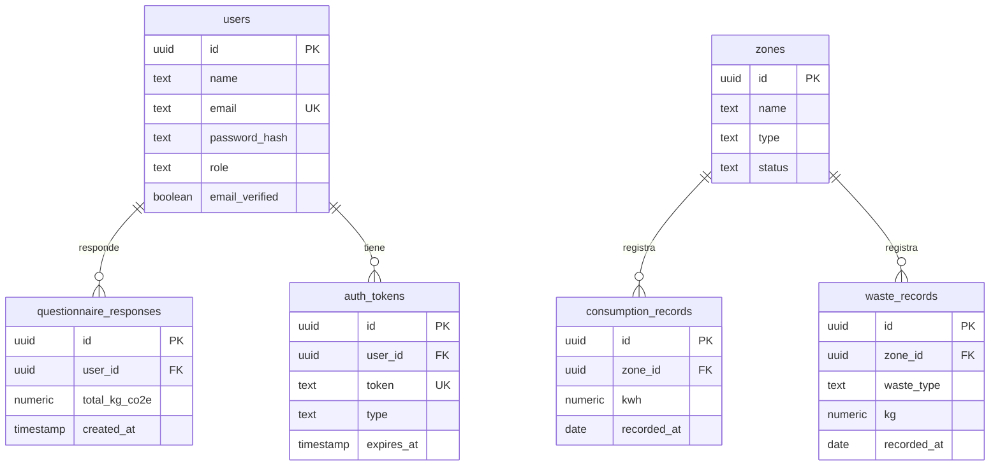

<div align="center">

# 🌱 HuellaTdeA

**Sistema web para calcular, visualizar y explorar la huella de carbono del Tecnológico de Antioquia**

Cuestionario mensual para estudiantes y docentes · registro de consumo eléctrico y residuos por zona · dashboards · simulador de escenarios en lenguaje natural

[](https://nodejs.org)
[](https://react.dev)
[](https://www.typescriptlang.org)
[](https://www.postgresql.org)
[](https://docs.docker.com/compose/)
[](https://huellatdea-web.onrender.com)

**[🌐 Probar la aplicación](https://huellatdea-web.onrender.com)**

</div>

---

## Contenido

- [¿Qué es HuellaTdeA?](#qué-es-huellatdea)
- [Funcionalidades](#funcionalidades)
- [Capturas](#capturas)
- [Probar la aplicación](#probar-la-aplicación)
- [Cómo se calcula la huella](#cómo-se-calcula-la-huella)
- [Inteligencia artificial](#inteligencia-artificial)
- [Arquitectura](#arquitectura)
- [Modelo de datos](#modelo-de-datos)
- [Tecnologías](#tecnologías)
- [Inicio rápido (local con Docker)](#inicio-rápido-local-con-docker)
- [Configuración](#configuración)
- [Comandos útiles](#comandos-útiles)
- [Pruebas](#pruebas)
- [Despliegue en Render](#despliegue-en-render)
- [API REST](#api-rest)
- [Estructura del repositorio](#estructura-del-repositorio)
- [Seguridad](#seguridad)
- [Limitaciones y trabajo futuro](#limitaciones-y-trabajo-futuro)
- [Autores](#autores)

---

## ¿Qué es HuellaTdeA?

El Tecnológico de Antioquia consume energía y genera residuos todos los días, pero esos datos —que existen en las facturas y en los registros— nunca se convertían en información: no se sabía cuánta huella de carbono produce cada zona del campus ni cómo contribuye cada persona.

**HuellaTdeA** resuelve ese problema en dos niveles:

| Nivel | Quién | Qué hace |
|---|---|---|
| **Individual** | Estudiantes y docentes | Responden un cuestionario mensual de hábitos (transporte, instalaciones, residuos y alimentación) y obtienen su huella en kg de CO₂e, su evolución y su comparación con el promedio de la comunidad. |
| **Institucional** | Administrador | Registra el consumo eléctrico y los residuos de cada zona del campus; el sistema calcula la huella institucional, la tendencia mensual y el ranking de zonas. |

La unidad de todo el sistema es el **dióxido de carbono equivalente (CO₂e)**, expresado en kilogramos o toneladas según la magnitud.

> Proyecto desarrollado como **trabajo de grado** de Ingeniería de Software del Tecnológico de Antioquia – Institución Universitaria.

## Funcionalidades

**Para todos los usuarios**

- Registro restringido al dominio `@correo.tdea.edu.co`, con **verificación por correo** y recuperación de contraseña.
- **Dashboard institucional** abierto a todos los roles: huella total, tendencia mensual, distribución por fuente, composición de residuos, ranking de zonas y variación interanual.
- **Exportación del reporte** en CSV y en PDF con membrete.
- **Simulador de escenarios** en lenguaje natural (_"¿Qué pasa si el 40 % de quienes vienen en carro se pasan al bus?"_).
- Página **¿Cómo se calcula?** con todas las fórmulas, factores y supuestos.
- Gestión de la **cuenta** (nombre, contraseña, eliminación con todas las respuestas).
- Interfaz **adaptable a celular**, con modo claro y oscuro.

**Estudiantes y docentes**

- **Cuestionario mensual** de tres pasos (una respuesta por mes calendario; si se vuelve a enviar, reemplaza a la anterior).
- **Dashboard personal**: huella por categoría, evolución mensual y comparación con el promedio TdeA.
- **Tres recomendaciones personalizadas** generadas por un modelo de lenguaje (con respaldo por reglas).
- **Historial** de respuestas.

**Administrador institucional**

- Gestión de **zonas** del campus (nombre, tipo y estado).
- Registro de **consumo eléctrico** (kWh) y de **residuos** (kg por tipo) por zona.

## Capturas

<table>
  <tr>
    <td align="center"><br><sub><b>Dashboard personal</b></sub></td>
    <td align="center"><br><sub><b>Dashboard institucional</b></sub></td>
  </tr>
  <tr>
    <td align="center"><br><sub><b>Simulador de escenarios</b></sub></td>
    <td align="center"><br><sub><b>¿Cómo se calcula?</b></sub></td>
  </tr>
</table>

> Las capturas usan datos de demostración.

## Probar la aplicación

La aplicación está publicada en **https://huellatdea-web.onrender.com** (API: `https://huellatdea-api.onrender.com`).

Cuentas de demostración (todas tienen datos ficticios):

| Rol | Correo | Contraseña |
|---|---|---|
| Estudiante | `johan.ramirez.osorio@correo.tdea.edu.co` | `Demo12345` |
| Docente | `veronica.toro.ospina@correo.tdea.edu.co` | `Demo12345` |

> ⏳ El despliegue usa el **plan gratuito de Render**: tras un rato sin uso los servicios se duermen y la primera visita puede tardar cerca de un minuto.
> Registrar una cuenta nueva exige un correo real `@correo.tdea.edu.co`, porque el sistema envía un mensaje de verificación.

## Cómo se calcula la huella

La huella individual es una **estimación anual en kg CO₂e** de lo que genera la actividad de la persona **dentro del campus**. Es la suma de cinco categorías, todas escaladas por los días que realmente asiste:

| Categoría | Qué considera |
|---|---|
| Transporte | Medio, distancia por trayecto y días de asistencia |
| Dispositivos | Laptop y carga de dispositivos |
| Instalaciones | Horas en el campus y espacios usados (aulas, laboratorios, auditorio, cafetería, biblioteca…) |
| Residuos | Frecuencia con que genera residuos |
| Alimentación | Tipo de dieta y frecuencia de consumo en la universidad |

La **huella institucional** combina el consumo eléctrico y los residuos registrados por el administrador con el transporte reportado por los usuarios.

**Principio de diseño:** todos los factores de emisión viven en **un único módulo** ([`backend/src/modules/footprint/emissionFactors.ts`](backend/src/modules/footprint/emissionFactors.ts)) que reutilizan el cuestionario, el reporte institucional, el simulador y la página de metodología. Cada valor indica su fuente, o se marca como **supuesto declarado** cuando no existe una fuente oficial. La página _¿Cómo se calcula?_ se genera desde esas mismas constantes (`GET /api/footprint/methodology`), por lo que nunca se desactualiza.

> Es una aproximación para tomar conciencia y comparar, no una medición certificada.

## Inteligencia artificial

La IA se usa **solo como interfaz de lenguaje, nunca como motor de cálculo**.

**Recomendaciones personalizadas** (`GET /api/questionnaire/recommendations`)

- Se envían únicamente los hábitos y la huella de la última respuesta, **sin nombre ni correo**.
- Se piden tres recomendaciones, una por categoría; la respuesta se valida con Zod y se guarda en memoria por respuesta.
- Sin clave de IA, o si el proveedor falla o responde 429, se devuelve un **catálogo por reglas** y la interfaz sigue funcionando.

**Simulador de escenarios** (`POST /api/simulations/ask`)

1. La persona escribe una pregunta (8 a 300 caracteres).
2. El modelo la traduce a **palancas** estructuradas: `cambio_transporte`, `reduccion_dias` (1 a 3 días), `eficiencia_energetica` (hasta 60 %) y `reduccion_residuos` (hasta 90 %), con un máximo de 5 por escenario.
3. El backend **valida** las palancas con Zod y rechaza valores fuera de rango o zonas inexistentes.
4. Un **motor determinista** calcula el escenario sobre la línea base (la última respuesta de cada persona y los consumos y residuos de los últimos 12 meses) con los mismos factores del cálculo oficial.

Por eso la misma pregunta siempre produce el mismo resultado. Hay un límite de **12 preguntas cada 10 minutos por persona**.

Funciona con cualquier proveedor compatible con la API de OpenAI; por defecto usa [Groq](https://console.groq.com) (plan gratuito). Ver [Configuración](#configuración).

## Arquitectura

Tres capas desacopladas, comunicadas por una API REST:



**Backend** — monolito modular. Cada dominio tiene sus rutas, controlador, servicio y repositorio:

```
routes → controller → service → repository → PostgreSQL
```

Módulos: `auth`, `zones`, `account`, `questionnaire`, `consumption` (consumo y residuos), `footprint`, `reports`, `simulation` y `recommendations`. El correo y el cliente del modelo de lenguaje viven en módulos compartidos, de modo que cambiar de proveedor no afecta la lógica de negocio.

**Frontend** — diseño atómico y patrón contenedor–presentacional:

```
atoms → molecules → organisms → containers → pages
```

Los contenedores concentran el estado y llaman a los servicios; las páginas componen las pantallas. El estado global se limita a tres contextos: autenticación, tema y avisos.

## Modelo de datos

Seis tablas, versionadas con nueve migraciones ([`database/migrations`](database/migrations)). Las claves foráneas usan `ON DELETE CASCADE`: al eliminar una cuenta o una zona se eliminan sus registros.



## Tecnologías

| Capa | Tecnologías |
|---|---|
| Frontend | React 19 · TypeScript · Vite 6 · Tailwind CSS 4 · Vitest + Testing Library |
| Backend | Node.js 24 · Express 4 · TypeScript · Zod · JWT · bcrypt · node:test (con `tsx`) |
| Base de datos | PostgreSQL 17 · node-pg-migrate |
| Servicios externos | Brevo (correo) · Groq (modelo de lenguaje) |
| Infraestructura | Docker Compose (desarrollo) · Render con Blueprint (producción) |

## Inicio rápido (local con Docker)

**Requisitos:** Git y Docker con Docker Compose v2. No hace falta instalar Node.js ni PostgreSQL: corren dentro de los contenedores. Los puertos `5173`, `4000`, `5432`, `8025` y `1025` deben estar libres.

```bash
# 1. Clonar el repositorio
git clone https://github.com/SotoDev-2901/HuellaTdeA.git
cd HuellaTdeA

# 2. Crear el archivo de variables de entorno a partir de la plantilla y revisar sus valores
cp .env.example .env

# 3. Levantar los servicios (base de datos, backend, frontend y Mailpit)
docker compose up -d --build

# 4. Crear las tablas
docker compose exec backend npm run migrate:up

# 5. Crear el usuario administrador
docker compose exec backend npm run seed:admin

# 6. (Opcional) Cargar datos de demostración
docker compose exec backend npm run seed:demo
```

| Servicio | Dirección |
|---|---|
| Aplicación | http://localhost:5173 |
| API | http://localhost:4000/api |
| Correos de prueba (Mailpit) | http://localhost:8025 |

**Cuentas locales**

- **Administrador** (`seed:admin`): `admin@correo.tdea.edu.co` con la contraseña `Admin12345`, valor por defecto solo para desarrollo (se cambia con `ADMIN_EMAIL` y `ADMIN_PASSWORD`).
- **Datos de demostración** (`seed:demo`): borra zonas, usuarios no administradores y sus registros, y crea **120 estudiantes y 25 docentes** (contraseña `Demo12345`) con hasta 12 meses de cuestionarios, más **10 zonas** con 24 meses de consumo y residuos. Los datos son deterministas: cada ejecución genera lo mismo.

En desarrollo, los correos de verificación y de recuperación llegan a **Mailpit** (http://localhost:8025), no a un buzón real.

## Configuración

Las variables van en el archivo `.env` de la raíz (no se versiona). Solo `JWT_SECRET` es obligatoria; el resto tiene valor por defecto.

**Backend**

| Variable | Descripción | Por defecto |
|---|---|---|
| `JWT_SECRET` | Clave de firma de los tokens. **Obligatoria.** | — |
| `PORT` | Puerto de la API | `4000` |
| `NODE_ENV` | Entorno | `development` |
| `FRONTEND_URL` | Dirección del frontend (la usan los enlaces de los correos y CORS) | `http://localhost:5173` |
| `CORS_ORIGINS` | Orígenes permitidos, separados por comas | `FRONTEND_URL` |
| `DATABASE_URL` | Cadena de conexión; si existe, tiene prioridad sobre las variables `DB_*` | — |
| `DB_HOST`, `DB_PORT`, `DB_NAME`, `DB_USER`, `DB_PASSWORD` | Conexión a PostgreSQL por partes | `localhost`, `5432`, `huellatdea`, `postgres`, `postgres` |
| `DB_SSL` | `true` para bases que exigen SSL | — |
| `MAIL_PROVIDER` | `smtp` o `brevo` | `smtp` |
| `MAIL_HOST`, `MAIL_PORT`, `MAIL_USER`, `MAIL_PASSWORD`, `MAIL_SECURE` | Servidor SMTP | `localhost`, `1025` (Mailpit) |
| `MAIL_FROM` | Remitente de los correos | `Huella TdeA <no-reply@tdea.edu.co>` |
| `BREVO_API_KEY` | Clave de la API de Brevo (con `MAIL_PROVIDER=brevo`) | — |
| `AI_API_KEY` | Clave del proveedor de IA. Sin ella el sistema sigue funcionando | — |
| `AI_BASE_URL` | URL base compatible con OpenAI | `https://api.groq.com/openai/v1` |
| `AI_MODEL` | Modelo | `openai/gpt-oss-120b` |
| `ADMIN_EMAIL`, `ADMIN_PASSWORD`, `ADMIN_NAME` | Cuenta que crea `seed:admin` | `admin@correo.tdea.edu.co`, `Admin12345` (solo desarrollo), `Administrador TdeA` |
| `SEED_DEMO` | `true` carga datos de demostración en el primer arranque (solo si la base no tiene usuarios) | — |

**Frontend**

| Variable | Descripción |
|---|---|
| `VITE_API_URL` | Dirección de la API terminada en `/api`. Se incorpora al compilar. |

### Correo real (SMTP)

Sin `MAIL_USER` se usa Mailpit. Para enviar correos reales:

```env
MAIL_HOST=smtp.office365.com      # o smtp.gmail.com, smtp.sendgrid.net, etc.
MAIL_PORT=587
MAIL_SECURE=false                 # true solo para el puerto 465
MAIL_USER=cuenta@dominio.edu.co
MAIL_PASSWORD=contraseña-o-app-password
MAIL_FROM="Huella TdeA <cuenta@dominio.edu.co>"
```

Gmail y Office 365 suelen exigir una _contraseña de aplicación_ o habilitar SMTP autenticado. Con `MAIL_USER` definido, los correos de verificación llegan a los buzones reales.

### Correo por API (Brevo)

Donde el hosting bloquea SMTP (por ejemplo, algunos planes gratuitos), se envía por la API HTTPS de [Brevo](https://www.brevo.com):

```env
MAIL_PROVIDER=brevo
BREVO_API_KEY=xkeysib-...
MAIL_FROM="Huella TdeA <remitente-verificado@dominio.co>"
```

El remitente debe estar **verificado** en Brevo (_Senders, Domains & Dedicated IPs_).

### Recomendaciones y simulador con IA

Funciona con cualquier proveedor compatible con OpenAI. Por defecto, [Groq](https://console.groq.com), que ofrece un plan gratuito sin tarjeta:

```env
AI_API_KEY=gsk_...
# Opcionales (valores por defecto):
AI_BASE_URL=https://api.groq.com/openai/v1
AI_MODEL=openai/gpt-oss-120b
```

Otras opciones: OpenRouter (`https://openrouter.ai/api/v1`, modelos con sufijo `:free`) o la API de Gemini en modo compatible con OpenAI (`https://generativelanguage.googleapis.com/v1beta/openai`). Los límites de los planes gratuitos cambian con el tiempo: revísalos en la consola del proveedor. Tras cambiar el `.env`, reinicia el backend: `docker compose up -d backend`.

## Comandos útiles

**Backend** (`cd backend`, o con `docker compose exec backend …`)

| Comando | Qué hace |
|---|---|
| `npm run dev` | API en modo desarrollo con recarga |
| `npm run build` / `npm start` | Compila a `dist/` y arranca la API |
| `npm run migrate:up` / `migrate:down` | Aplica o revierte migraciones |
| `npm run seed:admin` | Crea o actualiza el administrador |
| `npm run seed:demo` | Reinicia y carga los datos de demostración |
| `npm run start:render` | Migra, crea el administrador, carga datos demo si la base está vacía y arranca (lo usa Render) |
| `npm test` | Pruebas de integración |

**Frontend** (`cd frontend`)

| Comando | Qué hace |
|---|---|
| `npm run dev` | Servidor de desarrollo de Vite |
| `npm run build` | Revisa tipos y genera `dist/` |
| `npm run typecheck` | Solo revisión de tipos |
| `npm test` | Pruebas con Vitest |

## Pruebas

**110 pruebas automatizadas**:

- **95 de backend** (`node:test` con `tsx`): pruebas de integración sobre la API. Cada caso levanta la aplicación, crea los datos que necesita y verifica la respuesta HTTP y el efecto en la base de datos. Se ejecutan **en serie** sobre una base de datos de pruebas. El motor del simulador se prueba además de forma aislada, sin base de datos.
- **15 de frontend** (Vitest + Testing Library): componente `Input`, formulario de registro, formato de unidades y paginación.

```bash
docker compose exec backend npm test
docker compose exec frontend npm test
```

> Las pruebas de autenticación leen el correo desde Mailpit: ejecútalas con la configuración de correo por defecto.

## Despliegue en Render

El archivo [`render.yaml`](render.yaml) describe todo el despliegue (un **Blueprint**): una base de datos PostgreSQL gestionada, la API (servicio web Node.js) y el frontend (sitio estático).

### 1. Antes de empezar

1. El código debe estar en la rama `main` de GitHub.
2. **Correo (Brevo, gratis):** Render puede bloquear SMTP en el plan gratuito, por eso el despliegue usa la API de Brevo. Crea una cuenta, **verifica** el correo remitente y genera una API key.
3. **IA (opcional):** una clave de Groq. Sin ella, las recomendaciones usan el catálogo por reglas y el simulador solo permite los ejemplos.
4. Elige una **contraseña de administrador** de al menos 10 caracteres.

### 2. Crear el Blueprint

En Render: **New → Blueprint**, conecta el repositorio (rama `main`) y completa los valores secretos:

| Variable | Valor |
|---|---|
| `ADMIN_PASSWORD` | La contraseña de administrador elegida |
| `BREVO_API_KEY` | La clave de Brevo |
| `MAIL_FROM` | `Huella TdeA <correo-verificado-en-brevo>` |
| `AI_API_KEY` | La clave de Groq (opcional) |
| `FRONTEND_URL` y `VITE_API_URL` | Déjalas vacías por ahora (paso 3) |

### 3. Conectar frontend y API (una sola vez)

Las dos direcciones públicas solo se conocen después del primer despliegue:

1. Copia la URL de `huellatdea-web` y ponla en **`FRONTEND_URL`** del servicio `huellatdea-api`.
2. Copia la URL de `huellatdea-api` y ponla, **terminada en `/api`**, en **`VITE_API_URL`** de `huellatdea-web` (por ejemplo `https://huellatdea-api.onrender.com/api`).
3. Redespliega ambos servicios (_Manual Deploy → Deploy latest commit_). `VITE_API_URL` se incorpora al compilar, así que el frontend debe reconstruirse.

### 4. Qué hace el arranque de la API

`npm run start:render` ejecuta, en orden: **migraciones → crea o actualiza el administrador** (`admin@correo.tdea.edu.co` con tu `ADMIN_PASSWORD`) → **carga datos de demostración solo si la base no tiene usuarios** y `SEED_DEMO=true` → inicia el servidor. Para no cargar datos de demostración, pon `SEED_DEMO=false`.

### 5. Verificación

- `https://<api>/health/db` debe responder `{"status":"ok","database":"ok"}`.
- Abre el frontend e inicia sesión con el administrador y con una cuenta de demostración.
- Regístrate con un correo `@correo.tdea.edu.co` real y confirma que llega el correo de verificación.

### Límites del plan gratuito

- Los servicios web **se duermen** tras un rato sin uso: la primera visita puede tardar casi un minuto.
- La base de datos gratuita tiene **vigencia limitada**: confirma el plazo en el panel de Render y haz una copia si necesitas conservar datos.
- Los datos de demostración usan correos inventados: no recibirán mensajes.

## API REST

Prefijo `/api`. Todas las rutas, salvo `auth` y `health`, exigen el token JWT en la cabecera `Authorization: Bearer <token>`.

| Módulo | Endpoints | Acceso |
|---|---|---|
| **Salud** | `GET /health` · `GET /health/db` | Público |
| **Auth** | `POST /api/auth/register` · `login` · `verify-email` · `resend-verification` · `forgot-password` · `reset-password` | Público |
| **Cuenta** | `GET /api/account` · `PATCH /api/account` · `POST /api/account/change-password` · `POST /api/account/delete` | Autenticado |
| **Cuestionario** | `POST /api/questionnaire` · `GET /api/questionnaire` · `GET …/eligibility` · `GET …/dashboard` · `GET …/recommendations` | Autenticado |
| **Zonas** | `GET` y `POST /api/zones` · `PATCH` y `DELETE /api/zones/:id` | Administrador |
| **Consumo eléctrico** | `GET` y `POST /api/consumption` · `PATCH` y `DELETE /api/consumption/:id` | Administrador |
| **Residuos** | `GET` y `POST /api/waste` · `PATCH` y `DELETE /api/waste/:id` | Administrador |
| **Reportes** | `GET /api/reports/institutional?from&to` · `GET /api/reports/institutional-summary` | Autenticado |
| **Metodología** | `GET /api/footprint/methodology` | Autenticado |
| **Simulador** | `GET /api/simulations/options` · `POST …/run` · `POST …/ask` | Autenticado |

## Estructura del repositorio

```
HuellaTdeA/
├── backend/                  API REST (Node.js, Express, TypeScript)
│   ├── src/
│   │   ├── modules/          auth, zones, account, questionnaire, consumption,
│   │   │                     footprint, reports, simulation, recommendations
│   │   ├── shared/           correo, cliente del modelo de lenguaje, middlewares, errores
│   │   └── config/           variables de entorno y conexión a la base de datos
│   ├── scripts/              seed-admin, seed-demo, seed-demo-if-empty
│   └── tests/                pruebas de integración
├── frontend/                 Aplicación React + TypeScript + Vite + Tailwind
│   └── src/                  components (atoms, molecules, organisms), containers,
│                             pages, services, context, lib
├── database/migrations/      Migraciones versionadas (node-pg-migrate)
├── assets/screenshots/       Capturas usadas en este README
├── docker-compose.yml        Entorno local: db, backend, frontend y Mailpit
├── render.yaml               Blueprint de despliegue en Render
└── .env.example              Plantilla de variables de entorno
```

## Seguridad

- Registro limitado al dominio institucional y **verificación obligatoria del correo** antes de iniciar sesión.
- Contraseñas con **bcrypt**; sesión con **JWT de 8 horas**.
- **Control de acceso por rol** en el backend (`requireAuth`, `requireRole`) y en el frontend (`RoleRoute`).
- Entradas validadas con **Zod**; mensajes de error genéricos en el inicio de sesión y la recuperación de contraseña, para no revelar qué dato falló.
- **CORS** limitado al dominio del frontend.
- En producción, `seed:admin` **exige** una `ADMIN_PASSWORD` de al menos 10 caracteres.
- La IA no recibe datos personales y su salida siempre se valida.
- Los secretos (`.env`, claves de Brevo y de la IA) **no se versionan**. Genera claves nuevas para producción y no reutilices las que se hayan compartido en chats o capturas.

## Limitaciones y trabajo futuro

- Varios supuestos de ingeniería no tienen fuente oficial (rendimiento de combustible, potencia de equipos, consumo de las instalaciones, residuos por día y frecuencias de alimentación): están marcados como _supuesto declarado_ y requieren calibración con mediciones reales del campus.
- El **transporte institucional** se estima a partir de la última respuesta de cada usuario; no existe una medición directa.
- Pendientes de seguridad: límite de intentos de inicio de sesión y revocación de tokens.
- El caché de recomendaciones vive en memoria y se pierde al reiniciar la API.
- Sin pruebas de extremo a extremo ni integración y entrega continuas (CI/CD).
- Ideas: recordatorios mensuales para responder el cuestionario, medición directa del transporte y guardado de escenarios del simulador.

## Autores

- **Luis Felipe Soto Palacios**
- **Nicolás Álvarez Lopera**

**Director:** Joan Sebastián Ruiz Zapata

Tecnológico de Antioquia – Institución Universitaria · Ingeniería de Software · Medellín, Colombia · 2026
